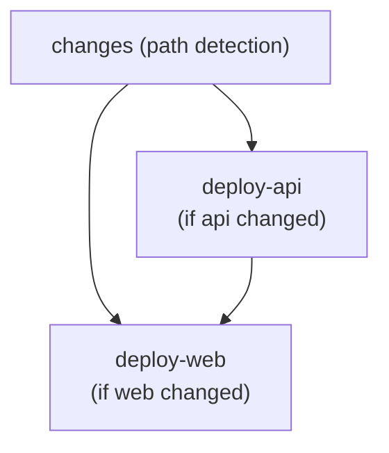

# CI/CD Pipeline

The GitHub Actions workflows. CI and deployment use `dorny/paths-filter` change detection, so only affected services are tested and deployed. Two look after the `@jswob/*` packages in an app: the upstream workflow takes the app's fixes to them back to bun-monorepo, and the toolkit sync workflow finishes Renovate's updates of them.

<!-- template:start -->

In bun-monorepo, the template, the release workflow publishes the packages, and the two above never run.

<!-- template:end -->

---

## `ci.yml` -- Continuous Integration (PRs to `master`)

| Job                | Triggered By                                                         | Actions                                                                    |
| ------------------ | -------------------------------------------------------------------- | -------------------------------------------------------------------------- |
| lint-and-typecheck | `apps/api/**`, `apps/web/**`, `apps/workbench/**`, `packages/**`     | `bun install` + `bun lint`                                                 |
| test-api           | `apps/api/**`, `packages/**`                                         | Postgres service container + `bun api:test`                                |
| test-web           | `apps/web/**`, `apps/workbench/**`, `apps/api/src/**`, `packages/**` | `bun web:test`, `bun ui:test`, `bun designs:test`; the template's engine   |
| test-packages      | `apps/evals/**`, `.claude/**`; the template's packages and scripts   | `bun evals:test`; the template's packages, on a Postgres service container |

---

## `deploy.yml` -- Continuous Deployment (push to `master`)

Deployment order: **api -> web** (sequential). Concurrency group `deploy` queues runs (`cancel-in-progress: false`). Nothing deploys until the `FLY_APP_NAME` variable is set ([cloud-deployment.md](cloud-deployment.md) § Quick Start), so a new app's pushes stay green before it has hosting.

**Path filters:**

| Service | Trigger Paths                                                                                                                       |
| ------- | ----------------------------------------------------------------------------------------------------------------------------------- |
| API     | `apps/api/**`, `packages/**` but the development tools and the UI, `docker/api/**`, `bun.lock`, `deploy.yml`, `deploy/fly-api.toml` |
| Web     | `apps/web/**`, `packages/**` but the development tools, `bun.lock`, `deploy.yml`                                                    |

The development tools (the design workbench, the evals harness, the toolkit) are imported by no deployed service, so a change to them alone deploys nothing.

---

<!-- template:start -->

## `release.yml` -- The packages (push to `master`, or by hand)

| Job      | Triggered By        | Actions                                                                                       |
| -------- | ------------------- | --------------------------------------------------------------------------------------------- |
| release  | push to `master`    | changesets/action: opens the "Release packages" PR, or, once it merged, `bun release:publish` |
| snapshot | `workflow_dispatch` | `changeset version --snapshot next` + `bun release:publish --tag next`; nothing is committed  |

It publishes with npm's trusted publishing, so it needs no token. Each package's trusted publisher on
npmjs.com names this repo and `release.yml`, and allows `npm publish` (`TEMPLATE.md` § Releasing
the packages). The repo must allow GitHub Actions to create pull
requests (Settings → Actions → General). A PR opened with `GITHUB_TOKEN` starts no CI, so the
"Release packages" PR has none: it changes only versions, changelogs and the lock. Changesets'
configuration is `.changeset/config.json`.

---

<!-- template:end -->

## `upstream.yml` -- Fixes travel home (push to the default branch touching `patches/@jswob*`, or by hand)

An app fixes a toolkit package in place with `bun toolkit patch` and ships the patch at once. Once
the patch reaches the app's default branch, this workflow runs `toolkit upstream --push` against a
checkout of `jswob/bun-monorepo`: one branch per patched package, `upstream/<app>/<package>`, with
the patch replayed, a changeset, the package's tests, and a pull request there linking the app's
commit. A conflict or a failed test opens it as a draft. Running it again updates the same pull
request. The bump comes from the app's commit (`fix(kit)!:` is breaking), so this run and one made
by hand in a session agree.

It runs as the toolkit's GitHub App, which pushes the branch and opens the pull request in
`bun-monorepo`. A pull request opened by an App starts CI, unlike one opened with `GITHUB_TOKEN`.
Without `TOOLKIT_APP_ID` the job is skipped.

---

## `toolkit-sync.yml` -- Renovate's updates finished (push to a `renovate/**` branch)

Renovate bumps the `@jswob/*` packages and their lockfile entries, and nothing else. On its branch
this job runs `toolkit carry`, which deletes each patch the new version has the fix of and makes
again each one that still applies to it, then `toolkit sync`, which copies the packages' skills
into `.claude/`, and commits what changed to the branch. CI then runs on that commit. A patch that
no longer applies is left alone, and `bun lint` (`toolkit check`) names it, so the PR stays red
until someone makes the patch again on the new version.

It commits as the toolkit's GitHub App, since a commit pushed with `GITHUB_TOKEN` starts no CI.
Renovate stops updating a branch someone else committed to, so the toolkit's Renovate presets list the
App's commits in `gitIgnoredAuthors`; that is why the App must be named `jswob-toolkit`. Without
`TOOLKIT_APP_ID` the job is skipped.

---

## The toolkit's GitHub App

Both workflows above run as one GitHub App. Set up once:

1. Create a GitHub App on the `jswob` account (Settings → Developer settings → GitHub Apps), named
   `jswob-toolkit`: no webhook; repository permissions Contents read and write, Pull requests read
   and write.
2. Install it on `bun-monorepo` and on every app repo.
3. Generate a private key.
4. In each app repo: the App's id in the `TOOLKIT_APP_ID` variable, the private key in the
   `TOOLKIT_APP_KEY` secret.

---

## GitHub Actions Secrets

| Secret              | Used By                | Description                              |
| ------------------- | ---------------------- | ---------------------------------------- |
| `FLY_API_TOKEN`     | deploy-api             | Fly.io deployment token                  |
| `DATABASE_URL`      | deploy-api             | Neon pooled PostgreSQL connection string |
| `AUTH_PASSWORD`     | deploy-api             | Login password for authentication        |
| `JWT_SECRET`        | deploy-api             | JWT signing secret                       |
| `VERCEL_TOKEN`      | deploy-web             | Vercel deployment token                  |
| `VERCEL_ORG_ID`     | deploy-web             | Vercel org ID                            |
| `VERCEL_PROJECT_ID` | deploy-web             | Vercel project ID                        |
| `TOOLKIT_APP_KEY`   | upstream, toolkit-sync | The toolkit App's private key (an app)   |

## GitHub Actions Variables

| Variable         | Used By                | Description                                         |
| ---------------- | ---------------------- | --------------------------------------------------- |
| `FLY_APP_NAME`   | deploy-api, deploy-web | Fly.io app name (e.g. `app-api`)                    |
| `WEB_ORIGIN`     | deploy-api             | Vercel URL for CORS (e.g. `https://app.vercel.app`) |
| `TOOLKIT_APP_ID` | upstream, toolkit-sync | The toolkit App's id (an app)                       |

---

## Configuration Files

| File                                 | Purpose                      |
| ------------------------------------ | ---------------------------- |
| `.github/workflows/ci.yml`           | CI pipeline                  |
| `.github/workflows/deploy.yml`       | CD pipeline                  |
| `.github/workflows/upstream.yml`     | An app's patches, taken home |
| `.github/workflows/toolkit-sync.yml` | Renovate's updates, finished |
